# RoboSBSE — a Search-Based Robotics and Software Engineering Laboratory

RoboSBSE is a 2D robotics laboratory for **Search-Based Software Engineering (SBSE)**. It does two jobs:

1. **Optimise:** metaheuristics search for robot routes, controller parameters, warehouse task schedules,
   robotic-arm configurations, motions and pick-and-place plans, and multi-robot job allocations, single- or
   multi-objective. Every candidate is scored with real simulation or cost-model calculations, and results are
   compared against conventional baselines (A\*/Dijkstra, analytical and numerical inverse kinematics, a
   configuration-space motion planner, exhaustive enumeration, untuned defaults, greedy heuristics).
2. **Test software:** the same search machinery looks for *test scenarios* that make robot-controller
   software violate its declared properties. It found the four documented defects injected into a
   reactive controller, minimised the failing scenarios and saved them as reproducible regression tests.

It was built around the topics of the Search-Based Software Engineering lecture at the University of Passau
(local search, evolutionary algorithms, search-based testing, and later GP, improvement and repair).
**All five phases are implemented: 1 (functional MVP), 2 (expanded optimisation), 3 (advanced search and
testing), 4 (software evolution: genetic programming, program repair, genetic improvement) and 5 (robotics
extensions: planar robotic arm, multi-robot task allocation, dynamic environments).** Parts that are not
implemented are marked as such, in this README and inside the application.

| Simulation Laboratory | Search-Based Testing |
|---|---|
| 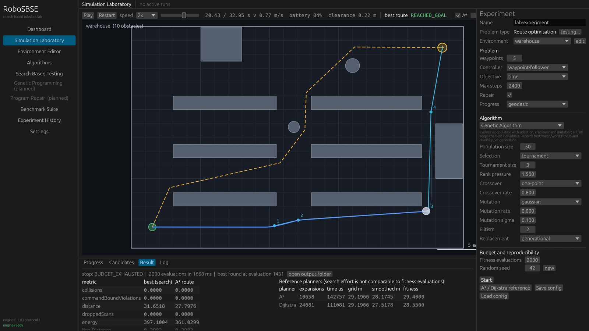 | 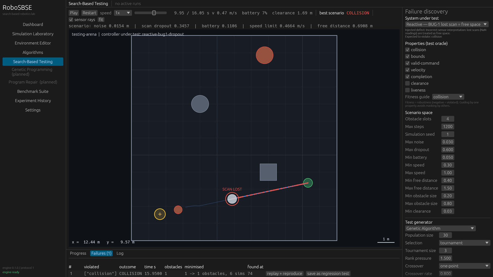 |
| **Benchmark Suite** | **Environment Editor** |
| 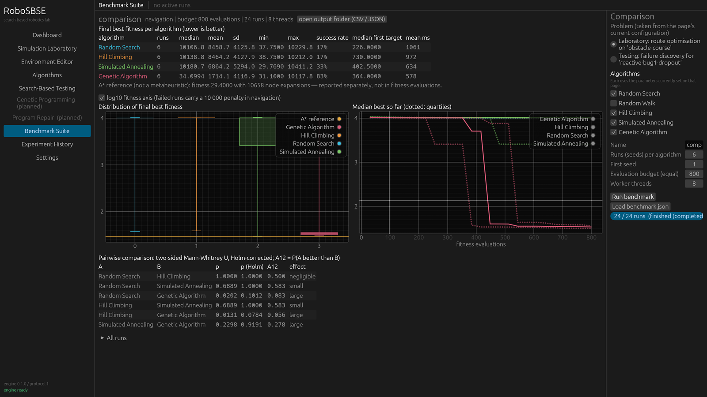 | 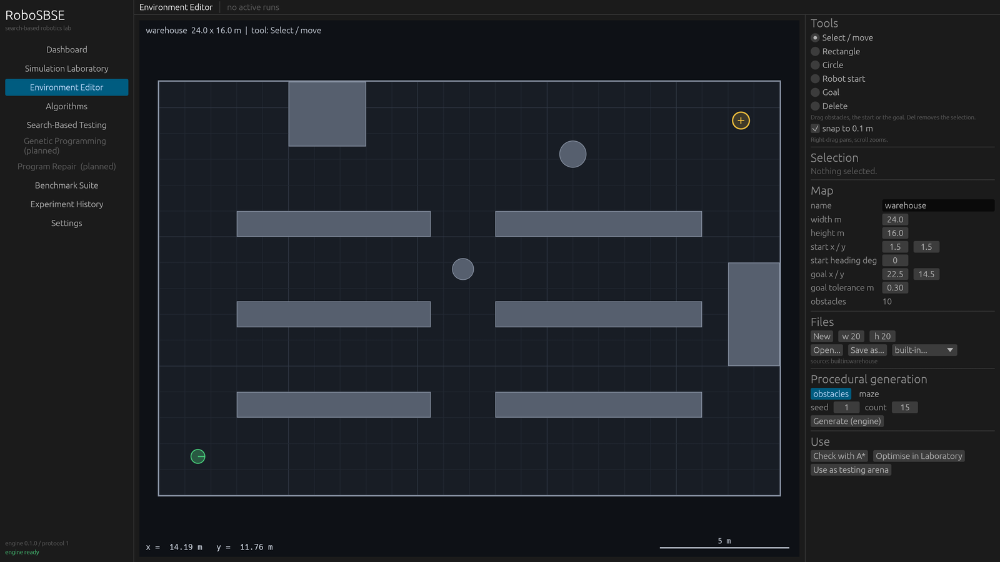 |

| **Warehouse scheduling** (Phase 2) | **Pareto front of routes** (Phase 2) |
|---|---|
| 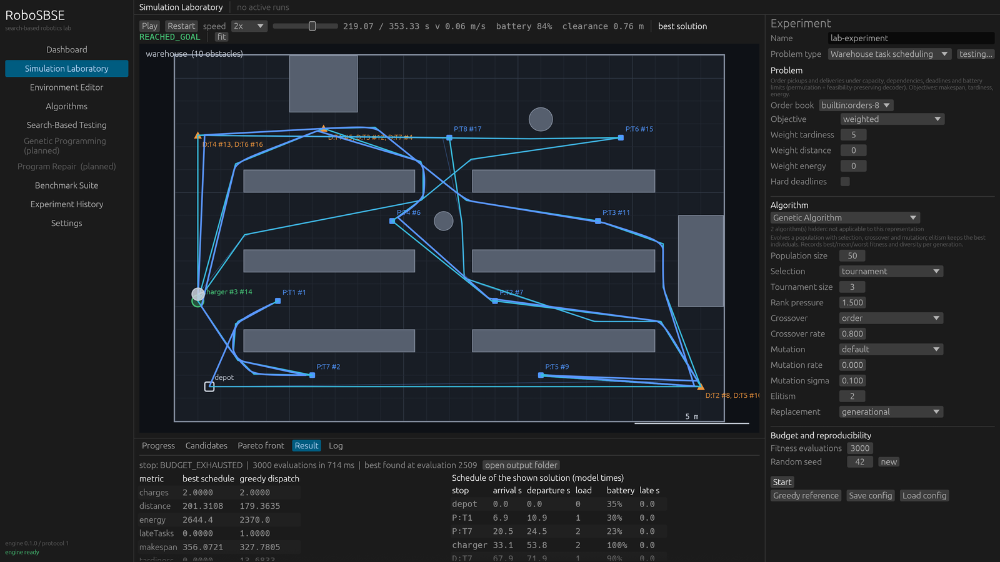 | 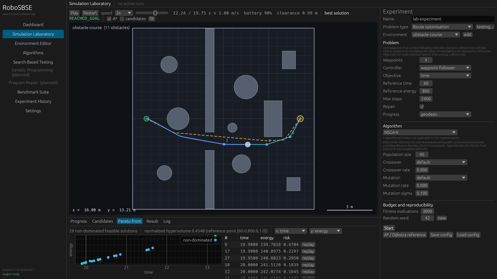 |
| **Controller tuning** (Phase 2) | **Dashboard** |
| 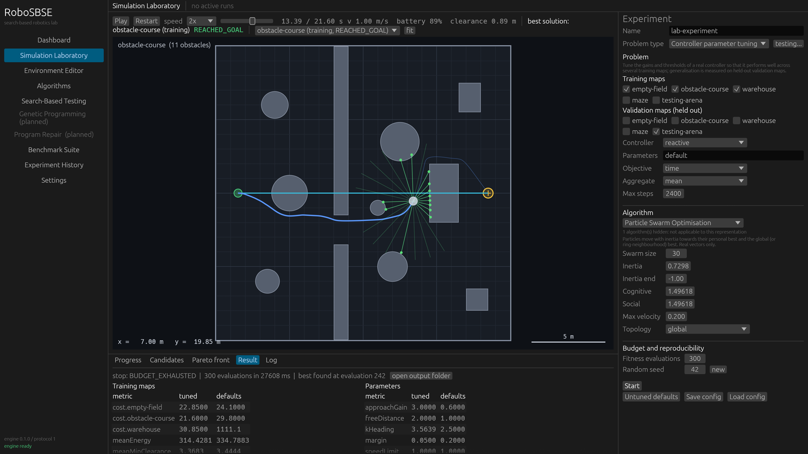 | 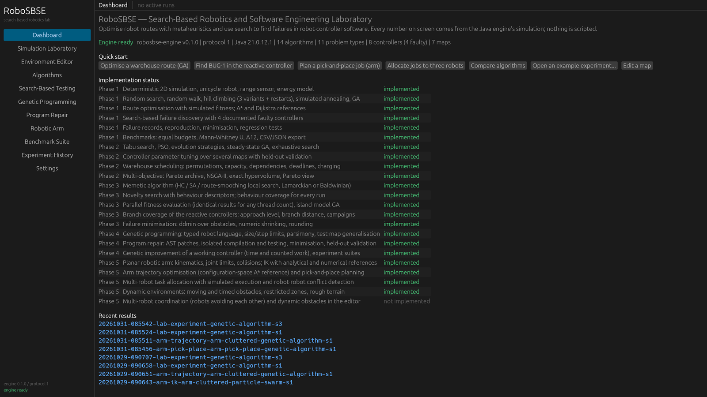 |
| **Coverage campaign** (Phase 3) | **Novelty search on the maze** (Phase 3) |
| 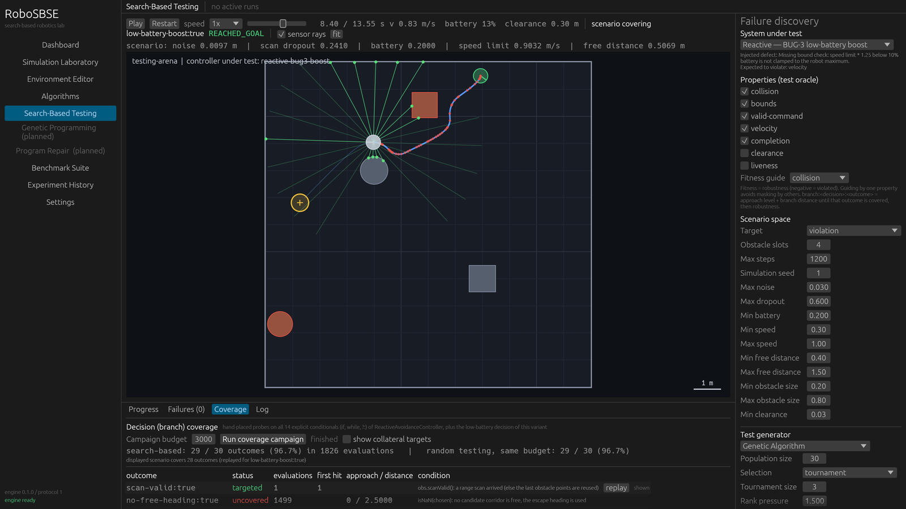 | 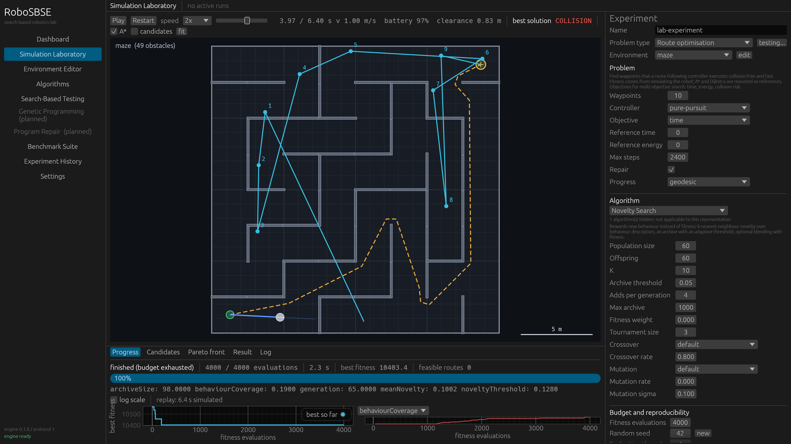 |
| **Genetic programming** (Phase 4) | **Program repair** (Phase 4) |
| 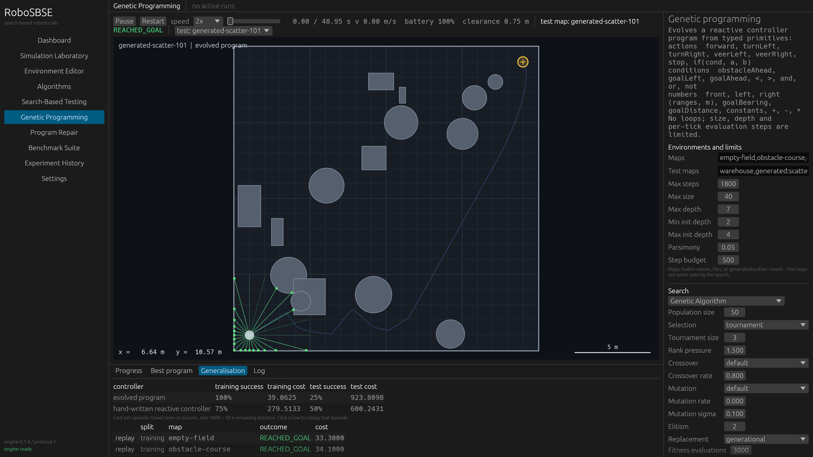 | 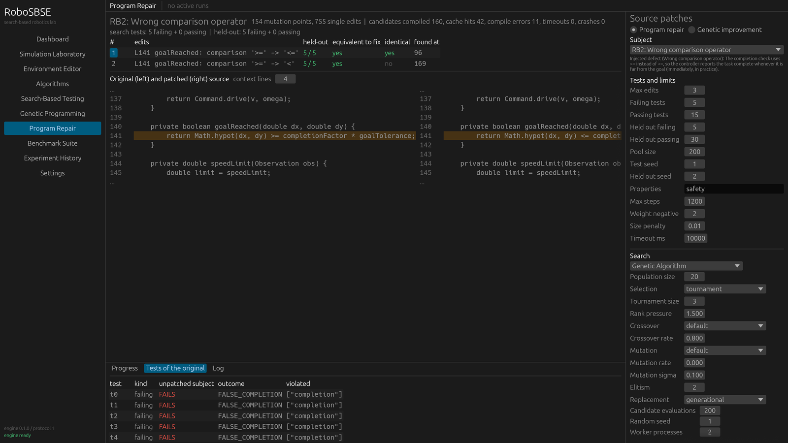 |
| **Robotic arm: pick and place** (Phase 5) | **Robotic arm: trajectory vs C-space planner** (Phase 5) |
|  |  |
| **Multi-robot task allocation** (Phase 5) | **Dynamic obstacle course** (Phase 5) |
|  |  |

All screenshots were captured by the application itself (`--capture`) after running real experiments.

## What is implemented

| Area | Implemented |
|---|---|
| Simulation | Deterministic fixed-step (dt = 0.05 s) unicycle robot with a disc body. It has speed, acceleration and turn-rate limits, a 24-ray range sensor with Gaussian noise and scan dropout, an energy/battery model, and detection of collisions, border exits, deadlocks, timeouts, invalid commands and false completion reports |
| Controllers | Waypoint follower, PID heading controller, pure-pursuit path follower, sensor-based reactive obstacle avoidance, plus **4 documented faulty variants** of the reactive controller |
| Search core | Generic `Problem` / `SolutionSpace` / operator interfaces. A single evaluation gateway enforces budgets exactly and records convergence, archives and target hits, and handles pause, resume and cancel. All randomness is seeded |
| Algorithms | Random search, random walk, hill climbing (first / best / stochastic, with or without random restarts), simulated annealing (Metropolis rule; geometric, linear, logarithmic and Lundy–Mees cooling; automatic T0), genetic algorithm (tournament / roulette / rank selection, 4 crossovers, 2 mutations, elitism, generational or (μ+λ) replacement, diversity tracking) |
| Problems | **Route optimisation** with simulation-based fitness, constraint-violation integral, geodesic progress penalty and Lamarckian repair. **Controller failure discovery**: robustness-based falsification over start, goal, obstacles, sensor noise, dropout, battery and controller configuration |
| Phase 2 algorithms | Tabu search (move attributes, aspiration, candidate lists, restarts), particle swarm optimisation (global/ring, constriction defaults), (μ/ρ +, λ) evolution strategy (self-adaptive or 1/5-rule σ), steady-state GA, exhaustive search, NSGA-II |
| Phase 2 problems | **Controller parameter tuning**: gains and thresholds of a real controller, evaluated by simulating several training maps, with held-out validation maps. **Warehouse task scheduling**: permutation priority lists decoded into schedules that respect capacity, dependencies and battery (automatic charging), with deadlines/tardiness. **Multi-objective navigation**: time, energy and collision risk |
| Phase 3 algorithms | Memetic algorithm (GA + hill climbing / SA / route smoothing, Lamarckian or Baldwinian), novelty search (behaviour descriptors, k-NN novelty, adaptive archive, fitness blending), island-model GA, synchronous PSO |
| Parallel evaluation | Whole generations evaluated on a thread pool with bit-identical results for every thread count; CPU time and behaviour coverage recorded for every run |
| Coverage-guided testing | Decision probes in the reactive controllers (14 decisions + BUG-3's), branch distance and approach level, branch-guided failure search, coverage campaigns with a random baseline, coverage tab in the UI; failure minimisation by ddmin + numeric shrinking |
| Genetic programming | Typed robot-decision language (motion primitives, sensor tests, comparisons, arithmetic, if-then-else), ramped half-and-half, subtree/point/constant mutation, subtree crossover, size/depth/step limits, invalid-program rejection, parsimony pressure; training vs unseen test maps against the hand-written controller |
| Program repair | Five faulty Java controllers (stopping distance, comparison operator, turn direction, boundary check, sensor interpretation); AST patches (operators, constants, conditions) via JavaParser; compilation and tests in isolated JVMs with time limits; failing/passing/held-out tests; ddmin patch minimisation; ranking; side-by-side code view |
| Genetic improvement | Constrained source edits to the correct controller that reduce travel time and counted work while passing a correctness suite; baseline vs improved report, held-out validation, NSGA-II trade-offs |
| Experiment automation | `suite` command: runs benchmark and coverage lists, writes one combined Markdown report |
| Robotic arm | Planar serial arm (any number of links) with forward kinematics, joint limits, capsule-link collision checking and a synchronised-move motion model (time, joint travel, effort, roughness). Problems: inverse kinematics (with posture weight for joint-angle optimisation), via-point trajectory optimisation (movement cost, energy, smoothness), pick-and-place planning (random keys over order and elbow choices). References: analytical IK, damped least squares, a configuration-space A\* planner, greedy planning and exhaustive enumeration |
| Multi-robot allocation | Random-key assignment and ordering of transport jobs to a fleet, geodesic cost model (makespan, total distance), greedy list scheduling as reference, simulated execution of every robot and detection of robot-robot conflicts |
| Dynamic environments | Moving obstacles (bounce or loop paths), obstacles present in a time window, restricted zones and rough terrain, in the simulator, sensors and planners; static maps behave exactly as before |
| Multi-objective core | Constrained Pareto dominance, fast non-dominated sorting, crowding distance, exact hypervolume (2-D sweep, 3-D slicing), a Pareto archive for every run, hypervolume-based benchmark comparisons |
| References | A\* and Dijkstra on an inflated occupancy grid, with line-of-sight smoothing. Their routes are executed and scored by the same fitness function, and their effort is reported in node expansions. Untuned controller defaults (tuning) and greedy dispatching (scheduling) are the other conventional baselines |
| Testing | Test oracle with 7 properties (robustness in [-1, 1]), differential check against the correct controller, greedy failure minimisation, self-contained failure records, a `reproduce` command, and a regression suite |
| Experiments | Self-contained result files. Benchmarks give every algorithm the same seeds and budget, and report summary statistics, median convergence, Mann–Whitney U with Holm correction and Vargha–Delaney A12. Everything exports to CSV and JSON |
| UI (Rust, egui) | Dashboard, Simulation Laboratory (incl. multi-robot replays with conflicts and dynamic obstacles drawn at replay time), Environment Editor, Algorithms, Search-Based Testing, Genetic Programming, Program Repair, Robotic Arm (click to move the target, animated motion with carried objects, reference comparison), Benchmark Suite, Experiment History and Settings. Parameter forms are generated from the engine's declarations. Live progress, replay, inspection of candidates and failures, and save/load for maps, experiments and failures |
| Quality | 221 JUnit tests plus 1 opt-in statistical benchmark test, and 29 Rust tests (including an end-to-end run against the real engine and headless editor-interaction tests). Example configs and regression records are themselves under test. CI workflow included |

## Measured results (from `examples/benchmarks`, 15 seeds each, equal budgets)

| Experiment | Finding |
|---|---|
| A: routes, obstacle course, 2000 evaluations | GA succeeds in 93% of runs with a median travel time of 19.6 s, against the A\* reference route's 19.5 s. Random search, hill climbing and SA succeed in 20 / 27 / 40% of runs. GA vs random: p(Holm) < 0.001, A12 = 0.03 (large effect) |
| A: routes, warehouse | GA 93% success, median 31.4 s (A\* 29.4 s). Random search 13% |
| C: BUG-2 (missing braking distance) | Random testing finds it in **2 of 15** runs, collision-guided genetic search in **12 of 15**. p(Holm) = 0.002, A12 = 0.14 |
| C: BUG-1 (lost scan = free space) | Easy: random testing hits it after a median of 5 evaluations. The GA finds more severe collisions (lower robustness, A12 = 0.19) |

| B: controller tuning (reactive controller, 3 maps, time + 20 × risk) | PSO best (median 30.76 vs 32.88 for random search, A12 = 0.996); the defaults fail one training map. Tuned parameters also improve the held-out map (12.95 vs 14.20) |
| D: weighted-sum GA vs NSGA-II (3 objectives) | Equivalent here: hypervolume 0.454 vs 0.457, p = 0.74. Both far above random search. Reported as a null result |
| Scheduling: 8 orders with dependencies and charging | SA and candidate-list tabu reach the best-known 322.2 s in most runs; greedy dispatching 396.2 (one late order); GA 363.3 |

| C (complete): BUG-2 failure discovery | GA 12/15 and novelty + fitness 14/15 vs random 2/15 and pure novelty 6/15; failures minimised to 1–2 obstacles |
| C: BUG-3 with a rare trigger (velocity oracle) | branch-distance guidance 8/15 (branch reached in 15/15) vs black-box GA 2/15 and random 1/15 |
| Memetic vs GA, novelty vs GA, islands | memetic and island variants: no significant difference (null results); novelty search covers 3× more maze end regions, but no method reaches the maze goal |
| Parallel evaluation | 1.95× faster with 2 threads, 2.7× with 4, identical results |
| E: genetic programming | GP fits its training maps but overfits: 31% of unseen maps with 2 training maps, 44% with 8 (random programs 21%, hand-written controller 75%) |
| G: arm inverse kinematics (10 seeds) | GA and NSGA-II reach the target in 10/10 runs, PSO 7/10, random search 1/10; analytical and numerical IK solve it exactly in a few hundred iterations |
| G: arm trajectory behind a post | the straight move collides; NSGA-II (constrained dominance) finds a feasible motion in 10/10 runs, the weighted-sum algorithms in 0–4/10; the configuration-space planner is the strongest method (fitness 3.22) |
| G: pick and place (4 objects) | GA reaches the enumerated optimum (24.80 s) in 8/10 runs, 8.5% faster than greedy planning (27.11 s); hill climbing never does |
| H: 3 robots, 12 jobs | NSGA-II median makespan 154.6 s vs 173.0 s for greedy list scheduling; but 5 of 6 best plans have robot-robot conflicts in simulation (greedy: none), since robots are not coordinated |
| I: dynamic obstacle course | the static A\* route collides with a moving guard; GA succeeds in 5/10 runs, PSO 3/10, random search 0/10 |
| F: program repair, RB1 | plausible patches in ~14 candidates for all three algorithms, but only 6/10 best patches pass held-out tests and only local search found the real fault: test-suite overfitting, measured. RB2–RB5 and genetic improvement: benchmarks not yet run (the suite was stopped for low memory) |

Details, commands and interpretation: [Phase 1](docs/experiments/phase1-results.md),
[Phase 2](docs/experiments/phase2-results.md), [Phase 3](docs/experiments/phase3-results.md),
[Phase 4](docs/experiments/phase4-results.md) and [Phase 5 results](docs/experiments/phase5-results.md).

## Quick start

Requirements: **JDK 21+**, **Rust stable** (1.95+, required by egui 0.36), and any GPU or driver with OpenGL 2+ (integrated graphics are fine).
Nothing else is downloaded except Gradle and Maven dependencies on the first build.

```powershell
# Windows (PowerShell). If java on PATH is older than 21, put the JDK into scripts\env.local.ps1:
#   $env:JAVA_HOME = "C:\path\to\jdk-21"
scripts\build.ps1 -Release      # engine jar + UI
scripts\run.ps1                 # start the laboratory
scripts\test.ps1                # all automated tests
scripts\demo.ps1                # headless: optimise a route, find BUG-1, reproduce it
```

```bash
# Linux / macOS
scripts/build.sh --release && scripts/run.sh
scripts/test.sh
```

Or run each half by hand:

```bash
cd backend/java-engine && ./gradlew test engineJar          # build/libs/robosbse-engine.jar
cd frontend/rust-ui && cargo run --release                  # UI finds the jar via the repository layout
```

### Headless engine (no UI)

```bash
java -jar backend/java-engine/build/libs/robosbse-engine.jar <command>
  run examples/experiments/nav-warehouse-ga.json            # one experiment -> experiments/results/...
  run examples/experiments/testing-bug2-ga.json             # failure discovery + minimised failure records
  run examples/experiments/warehouse-orders8-ga.json        # task scheduling (greedy reference, simulated replay)
  run examples/experiments/tuning-pid-pso.json              # controller tuning with validation maps
  run examples/experiments/nav-obstacle-course-nsga2.json   # Pareto front + hypervolume
  run examples/experiments/testing-bug3-branch.json --eval-threads 4   # white-box (branch-distance) testing
  coverage examples/coverage/coverage-bug3-ga.json          # coverage campaign + random baseline
  run examples/experiments/gp-controller.json --eval-threads 4    # genetic programming of a controller
  run examples/experiments/repair-rb2-ga.json               # program repair (patches + side-by-side diff)
  suite examples/suites/phase4.json                          # every Phase 4 experiment, one report
  benchmark examples/benchmarks/experiment-C-bug2.json      # comparison with statistics + CSV
  reproduce examples/faulty-controllers/regressions/bug2-braking-collision.json   # exit code 0 = reproduced
  plan examples/experiments/nav-maze-ga.json                # A* / Dijkstra reference
  generate-map maze --seed 3 --out my-maze.json
  capabilities                                              # algorithms, parameters, controllers, properties
  serve                                                     # JSON Lines protocol (used by the UI)
```

Every result directory contains the full configuration, with the map inlined, so re-running it
reproduces the same numbers.

## Repository layout

```text
robosbse/
├── backend/java-engine/          Java 21 + Gradle: search core, algorithms, simulator, problems,
│   └── src/main/java/org/robosbse/   testing, experiments, protocol, CLI (packages listed below)
├── frontend/rust-ui/             Rust + egui desktop laboratory (talks JSON Lines to the engine)
├── examples/
│   ├── maps/                     empty-field, obstacle-course, warehouse, maze, testing-arena,
│   │                             dynamic-obstacle-course, delivery-center
│   ├── arm/                      robotic-arm scenes (robosbse.arm/1)
│   ├── fleet/                    multi-robot instances (robosbse.fleet/1)
│   ├── dynamic-obstacles/        notes on moving/timed obstacles and zones (the maps are in maps/)
│   ├── experiments/              ready-to-run experiment configurations (navigation + testing)
│   ├── warehouse/                order books (robosbse.tasks/1) for task scheduling
│   ├── benchmarks/               Experiments A–I (Phase 5: G arm, H multi-robot, I dynamic course)
│   ├── suites/                   phase4 and phase5 experiment suites
│   └── faulty-controllers/       defect documentation + regressions/ (saved failure records)
├── docs/                         architecture, protocol, algorithms, research notes, experiments, roadmap
├── experiments/                  default output directory (results are git-ignored)
├── scripts/                      build / run / test / demo for PowerShell and bash
└── .github/workflows/ci.yml      CI: JUnit, CLI smoke test, cargo test with the real engine
```

Engine packages: `core` (abstractions, context, Pareto utilities, representations), `algorithms.baseline`,
`algorithms.local`, `algorithms.evolutionary`, `algorithms.multiobjective`, `algorithms.memetic`,
`algorithms.novelty`, `algorithms.parallel`, `geometry`, `simulation` (+ `controllers`, `controllers.faulty`),
`planning`, `problems` (+ `warehouse`, `fleet`), `arm`, `testing` (+ `coverage`), `geneticprogramming`,
`patching` (+ `sandbox`), `repair`, `improvement`, `experiments`, `protocol`, `cli`.

## Documentation

- [Architecture overview](docs/architecture/overview.md): components, the vertical slice, and design decisions
- [UI ↔ engine protocol](docs/architecture/protocol.md): versioned JSON Lines message catalogue
- [Algorithms](docs/algorithms/README.md): intuition, representation, operators, parameters, complexity and limits,
  including [tabu search](docs/algorithms/tabu-search.md), [PSO](docs/algorithms/particle-swarm.md),
  [evolution strategies](docs/algorithms/evolution-strategy.md), [NSGA-II / hypervolume](docs/algorithms/nsga2.md),
  [memetic algorithms](docs/algorithms/memetic.md), [novelty search](docs/algorithms/novelty-search.md) and
  [parallel evaluation / island model](docs/algorithms/island-model.md)
- [Coverage-guided testing](docs/research/coverage.md): instrumentation, branch distance, approach level, campaigns
- [Genetic programming](docs/algorithms/genetic-programming.md) and [program repair / genetic improvement](docs/research/program-repair.md)
- [Robotics extensions](docs/research/robotics-extensions.md): robotic arm, multi-robot allocation, dynamic environments
- [Problem formulations](docs/research/problem-formulations.md): representations, fitness, constraints, simulation assumptions, testing methodology
- [Faulty controllers](examples/faulty-controllers/README.md): the four injected defects and their regression records
- [Phase 1](docs/experiments/phase1-results.md), [Phase 2](docs/experiments/phase2-results.md),
  [Phase 3](docs/experiments/phase3-results.md), [Phase 4](docs/experiments/phase4-results.md) and
  [Phase 5 results](docs/experiments/phase5-results.md), and the
  [experiment report template](docs/experiments/template.md)
- [Positioning and related work](docs/research/positioning.md): how this differs from a path-planning simulator (no novelty claims)
- [Roadmap](docs/roadmap.md): Phases 2–5, mapped to the course topics

## Known limitations

- Obstacles are circles and axis-aligned rectangles. Moving and timed obstacles, zones and terrain exist (Phase 5), but the grid planners ignore moving obstacles, the Environment Editor cannot create dynamic elements (they are written as JSON), and the failure-discovery problem uses static arenas only.
- The robot pose is perfectly known (no localisation error). Only the range sensor is noisy.
- Route optimisation uses a fixed number of waypoints. The reactive controller can get trapped in U-shaped configurations (a documented liveness limitation, not an injected bug).
- Failure minimisation is greedy (1-minimal for its operations), not full delta debugging.
- Multi-robot coordination is **not implemented**: robots do not avoid each other, and replays report their conflicts without resolving them.
- The robotic arm is kinematic (no gravity, torques or dynamics; effort is a proxy for energy), links collide only with obstacles, and the configuration-space planner exists for two-link arms only.
- The correct reactive controller can collide when an obstacle corner falls between two of its 24 range rays (found in Phase 4, documented in the formulations, not fixed).
- Plausible patches are not proven correct; the repair module validates them on held-out tests and compares them with a reference fix.
- Coverage is decision coverage of the hand-instrumented reactive controller classes only; other controllers report it as unavailable.
- The maze is not solved by any implemented method with the fixed-length route encoding.
- Hypervolume values depend on the reference point, which every result records; compare them only within one configuration.
- The scheduling cost model ignores turning and controller dynamics. Replays quantify the gap (−1.8% in one check) but it does not feed back into the fitness.
- Passing the regression suite or failing to find a failure does not prove a controller correct.

## Troubleshooting

- **UI says "engine jar not found"**: run `scripts/build.ps1` (or `gradlew engineJar`), or set the path under *Settings*.
- **"Java 8 found"**: set `JAVA_HOME` or `ROBOSBSE_JAVA` to a JDK 21+ (the UI's Settings page can also point at `java.exe`).
- **Rust on Windows with the GNU toolchain: `dlltool ... program not found` or `could not create import library`**: the
  GNU toolchain needs binutils (`dlltool`, `as`) on PATH. `scripts/env.ps1` adds MSYS2's `mingw64\bin` when present.
  The MSVC toolchain does not need this.

## License

MIT, see [LICENSE](LICENSE).
