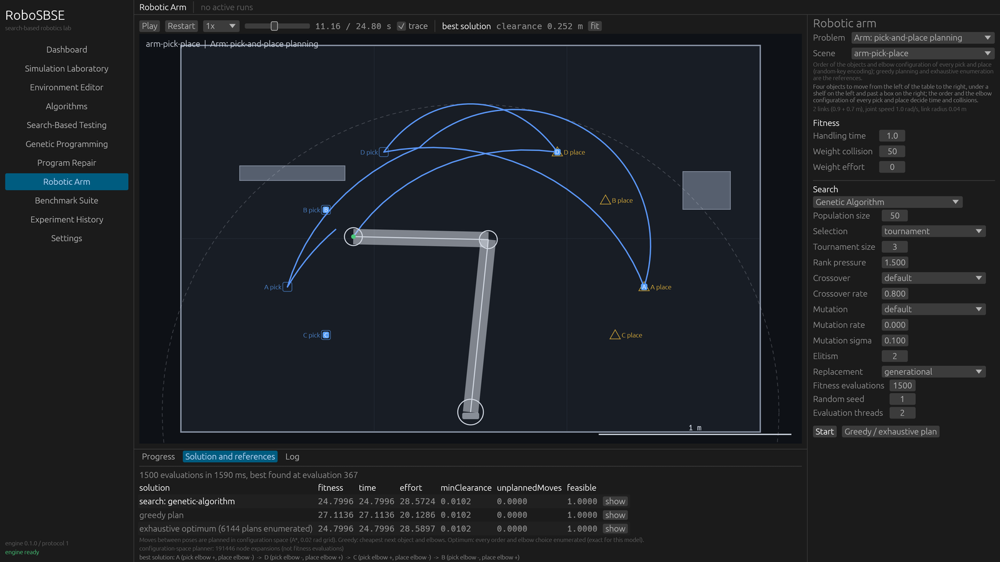
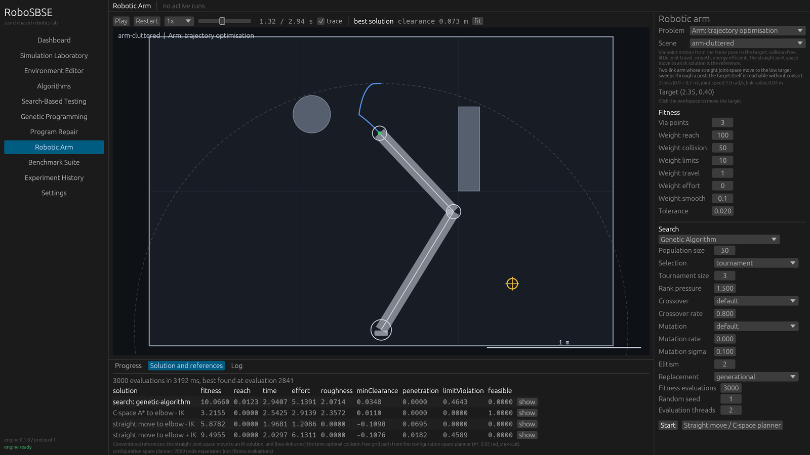
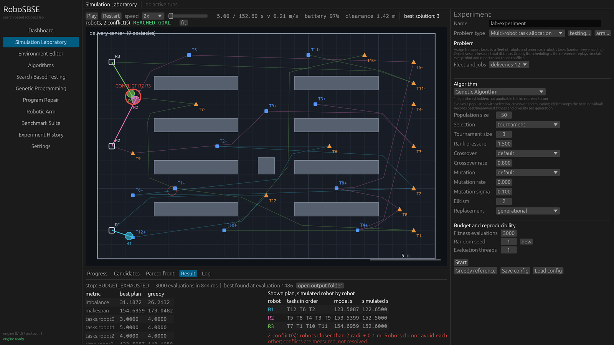
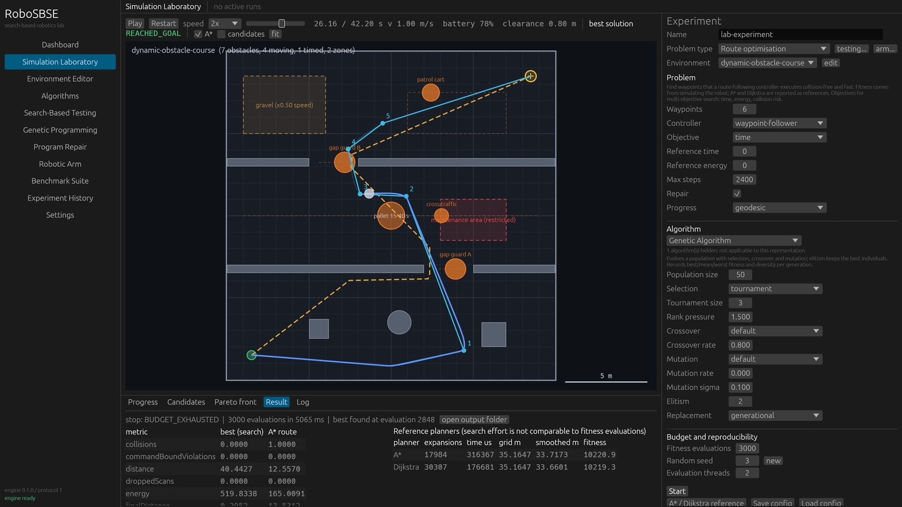

# Phase 5 results

All numbers come from one run of the Phase 5 suite on 2026-10-29:

```bash
java -jar backend/java-engine/build/libs/robosbse-engine.jar suite examples/suites/phase5.json --out experiments/phase5 --threads 2
```

The suite runs six benchmarks (`examples/benchmarks/experiment-G-*`, `-H-*`, `-I-*`). Every algorithm gets
the same seeds and the same evaluation budget. Comparisons use the two-sided Mann–Whitney U test with Holm
correction and the Vargha–Delaney A12. A12(A, B) is the probability that a run of A ends with a better
(lower) fitness than a run of B, so values near 0 mean B is clearly better. The whole suite took 2.5 minutes. Per-run details and the replays
of the multi-robot plans were extracted from the benchmark JSON files and by replaying the stored
solutions through the engine's `simulate` request.

Methods and models: [robotics-extensions.md](../research/robotics-extensions.md).



## G1: inverse kinematics (two-link arm among obstacles, `arm-cluttered`)

3000 evaluations, 10 seeds. Success = target within 1 cm, clearance ≥ 0 and no joint-limit violation.

| Method | Reached | Median final distance |
|---|---|---|
| Random search | 1/10 | 4.6 cm |
| Hill climbing (first, restarts) | 2/10 | 1.4 cm |
| Simulated annealing | 6/10 | 6.3 mm |
| Genetic algorithm | **10/10** | 4.3 mm |
| PSO | 7/10 | 0.0014 mm |
| NSGA-II | **10/10** | 2.6 mm |
| Analytical IK, elbow − | exact | 0 (clearance 10.6 cm) |
| Analytical IK, elbow + | violates the shoulder limit by 0.46 rad | 0 |
| Damped least squares (8 starts, 947 iterations in total) | yes | 0.0003 mm |

PSO converges almost exactly when it converges. Its three failing runs sit on the elbow-up solution and
violate the shoulder limit, which the default limit weight (1 per rad) penalises less than the distance it
saves. GA and NSGA-II always reach the 1 cm tolerance but do not refine further. GA and NSGA-II beat random
search and hill climbing significantly (p(Holm) ≤ 0.007; A12 of random search and HC against them ≤ 0.04). The two closed-form or numerical
references solve this problem exactly, at a cost of a few hundred iterations rather than thousands of
evaluations, so for a two-link arm search is not the method of choice. It becomes useful when the fitness
contains terms that IK cannot express (posture, clearance, several targets).

## G2: inverse kinematics of a redundant three-link arm (`arm-three-link`)

No closed form exists. Reached: random search 0/10, hill climbing 2/10, SA 6/10, GA **10/10**, PSO 7/10,
NSGA-II 9/10. Damped least squares reaches the target from every one of its 8 starts (456 iterations in
total). The ranking matches G1. GA, NSGA-II, SA and HC beat random search significantly.

## G3: trajectory optimisation (`arm-cluttered`, 3 via points, 4000 evaluations)

The low target lies behind a post. Moving straight to either IK solution sweeps the arm through the post.

| Method | Collision-free and reaching (best solution) | Runs with any feasible candidate | Median fitness | Best feasible fitness |
|---|---|---|---|---|
| Random search | 0/10 | 0/10 | 24.86 | – |
| Hill climbing | 0/10 | 0/10 | 7.76 | – |
| Simulated annealing | 2/10 | 4/10 | 5.05 | **3.18** |
| Genetic algorithm | 1/10 | 1/10 | 8.99 | 3.83 |
| PSO | 0/10 | 0/10 | 8.66 | – |
| NSGA-II | 6/10 | **10/10** | 6.66 | 3.89 |
| Straight move to elbow − IK | infeasible (penetration 11 cm) | | 5.88 | |
| Straight move to elbow + IK | infeasible | | 9.50 | |
| Configuration-space A* (0.02 rad grid, 2909 expansions) | feasible | | | 3.22 |

Findings:

- **The motion planner is the stronger method here.** It returns a feasible, time-optimal (on its grid)
  motion after 2909 node expansions. Only 9 of 60 search runs ended with a feasible best solution.
- **Constraint handling matters more than the algorithm.** NSGA-II compares candidates by constrained
  dominance and found a feasible trajectory in every run. The single-objective algorithms minimise a
  weighted sum, and in several runs an infeasible trajectory (a slight penetration, a slightly missed target)
  had a lower weighted fitness than any feasible one they had seen. SA found feasible candidates in 4 runs,
  but in 2 of them its best-by-fitness solution is infeasible.
- One SA run found a feasible motion with fitness 3.18, slightly better than the planner's 3.22. The planner
  minimises time on its grid; the fitness also counts joint travel and roughness.



## G4: pick-and-place planning (four objects, 1500 evaluations)

The model has 4! × 4⁴ = 6144 plans, so the exact optimum is known by enumeration: 24.80 s. Greedy planning
(cheapest next object) needs 27.11 s. The configuration-space planner made 192,951 node expansions for the
reference's moves.

| Method | Reached the optimum | Better than greedy | Median | Worst |
|---|---|---|---|---|
| Random search | 4/10 | 10/10 | 24.87 | 25.28 |
| Hill climbing | 0/10 | 9/10 | 25.78 | 28.22 |
| Simulated annealing | 0/10 | 7/10 | 25.42 | 125.86 (an invalid pose) |
| Genetic algorithm | **8/10** | 10/10 | 24.80 | 24.99 |
| PSO | 5/10 | 9/10 | 24.88 | 122.29 (an invalid pose) |

The GA plan is 8.5% faster than greedy. The search space is small, and random search with 1500 samples
already comes within 0.3% of the optimum. Local search on random keys does worse than random sampling: most
small changes to a key leave the decoded plan unchanged (plateaus), and the elbow genes switch
discontinuously. GA beats HC and SA significantly (A12 of HC and SA against GA ≤ 0.06). Random search also beats HC
significantly (A12 = 0.98).

## H: multi-robot task allocation (3 robots, 12 jobs, 3000 evaluations, 15 seeds)

Fitness = makespan + 0.1 × total distance. Greedy list scheduling: fitness 204.7, makespan 173.0 s.

| Method | Median fitness | Median makespan | Beat greedy | Best plan: makespan | Best plan: conflicts in the simulated replay |
|---|---|---|---|---|---|
| Random search | 194.1 | 161.9 s | 15/15 | 158.0 s | 2 |
| Hill climbing | 208.5 | 175.0 s | 6/15 | 159.1 s | 2 |
| Simulated annealing | 203.8 | 170.5 s | 9/15 | 158.0 s | 0 |
| Genetic algorithm | 188.2 | 158.0 s | 14/15 | 149.9 s | 4 |
| PSO | 191.4 | 160.5 s | 14/15 | 150.1 s | 1 |
| **NSGA-II** | **184.0** | **154.6 s** | 15/15 | **145.9 s** | 1 |
| Greedy list scheduling | 204.7 | 173.0 s | – | 173.0 s | 0 |

- NSGA-II's best plan has a makespan 16% shorter than greedy, and its median is 11% shorter. NSGA-II is
  significantly better than random search, HC and SA (their A12 against NSGA-II ≤ 0.06).
- Greedy list scheduling is a weak baseline on this instance: random sampling beats it in every run.
  Hill climbing and SA again suffer from random-key plateaus.
- **The cost model ignores interaction between robots, and the simulation shows the consequences.** Five of
  the six best plans contain robot-robot conflicts (robots closer than 0.6 m), between 1 and 4 each. The
  greedy plan has none. The shorter makespans may not be achievable without coordination (waiting,
  re-routing), which is not implemented. Conflicts are reported, not penalised: adding them to the fitness
  would mean simulating every robot for every evaluation, while the cost model takes about 4 µs per
  evaluation (3000 evaluations in a median of 13 ms).
- Model and simulation agree: simulated makespans are 0.6–2.8% shorter than modelled (the waypoint follower
  cuts corners of the grid route).



## I: route optimisation on the dynamic obstacle course (6 waypoints, 3000 evaluations)

The A* route, planned on the static map, collides with a gap guard after 13.25 s.

| Method | Successful runs | Median time of successful routes | Failed runs ending in a moving-obstacle collision |
|---|---|---|---|
| Random search | 0/10 | – | 6 |
| Hill climbing | 0/10 | – | 7 |
| Simulated annealing | 1/10 | 40.95 s | 3 |
| Genetic algorithm | **5/10** | 43.75 s (best 42.35) | 3 |
| PSO | 3/10 | 42.90 s (best 42.35) | 2 |
| A* reference | collides | – | yes |

The GA succeeds significantly more often than random search and hill climbing (p(Holm) ≤ 0.003;
A12 of random search and HC against the GA ≤ 0.02). Successful routes are 38.6–60.3 m long (median 41.8 m), against 33.7 m for the static A* route. Their
detours and waypoint placement time the gap crossings and avoid the cross traffic. This
only works because the fitness simulates the moving obstacles. The approach is still fragile: half of the
GA runs fail, and the fixed waypoint count limits how much a route can wait.



## Threats to validity

- 10–15 seeds per configuration. Effect sizes are large where significant, but rare behaviours (e.g. SA's
  invalid pick-and-place plans) are estimated from few runs.
- One instance per problem. The arm scenes and the fleet instance were designed for this study (the
  scene-design scripts are not part of the repository), and the results do not generalise beyond them.
- Default parameters were used for every algorithm; none was tuned for these problems. Penalty weights
  (limits, collisions) shape the outcome, as G1 and G3 show.
- The references are of different kinds: closed-form and numerical IK, a grid motion planner,
  enumeration, greedy heuristics. Their effort (iterations, expansions) is not comparable to fitness
  evaluations.
- The multi-robot cost model and the conflict check are approximations. Conflicts are counted on simulated
  trajectories of robots that do not see each other.

## Not run, carried over from Phase 4

The Phase 4 program-repair benchmarks RB2–RB5 and the genetic-improvement benchmark have still not been run.
The Phase 4 suite was stopped because the machine ran low on memory, and they will be rerun only on request.
